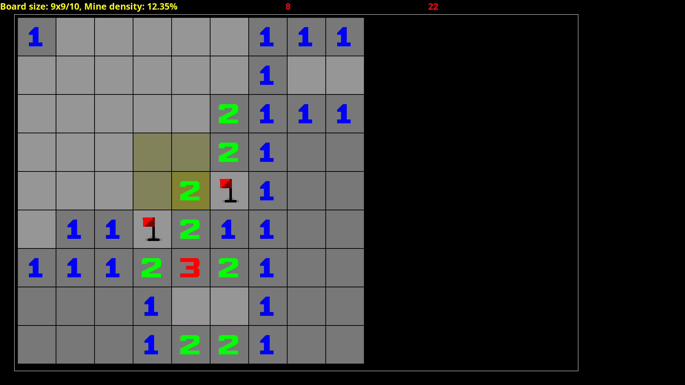
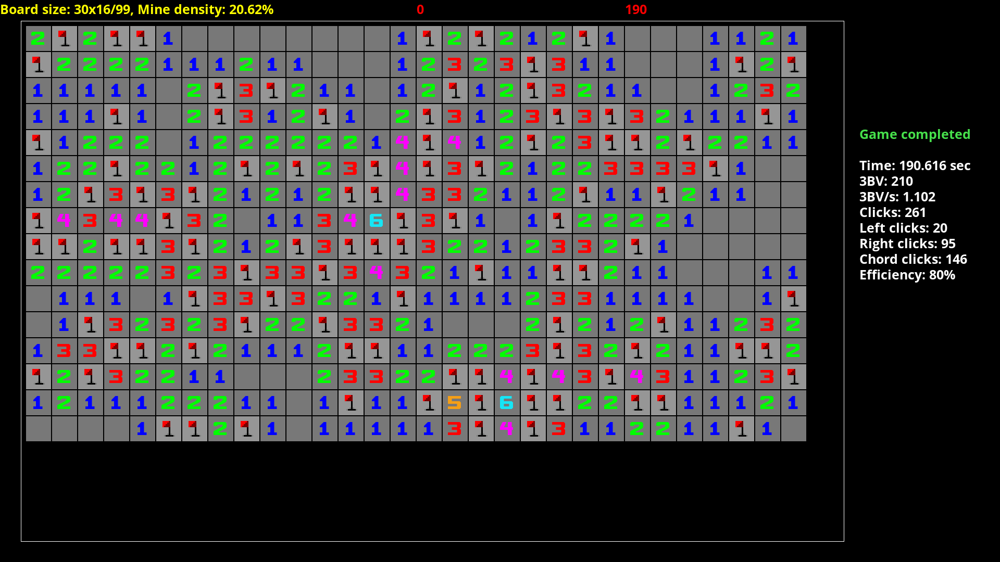

# minesweeper

## Installing SDL2
To install SDL_TTF on Ubuntu, run the following command:

```bash
sudo apt install libsdl2-ttf-dev
```

## Playing the game
Compile the game binary at the root of the repository:

```bash
make # Produces the game binary
```

The game has multiple difficulties, ranging from Beginner to Expert, with increasingly difficult boards.
By default, the game launches with a Beginner board, but it can be changed with command-line options:

```bash
./game # Launch the game in Beginner (by default)
./game <beg/int/exp> # Launch the game in the selected difficulty (beg, int or exp)
./game <width> <height> <mines> # Launch the game in a custom difficulty with a specified board configuration
```

Click a cell with left click or 'A', place a flag with right click or 'Q'.
To start a new game with a new board, press Space.
To exit the game, press Escape.



